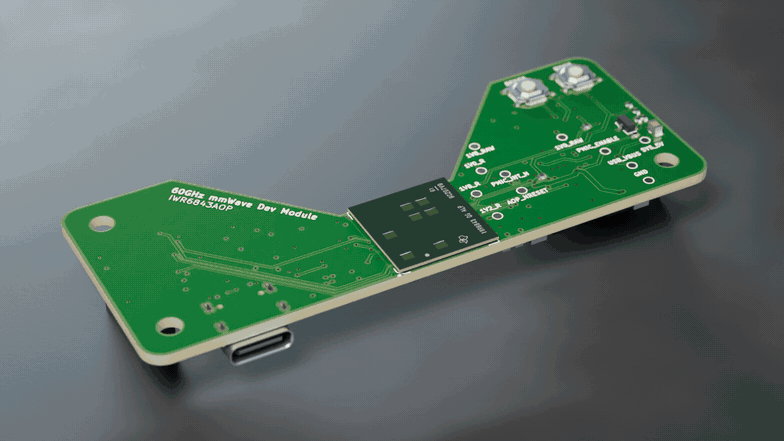
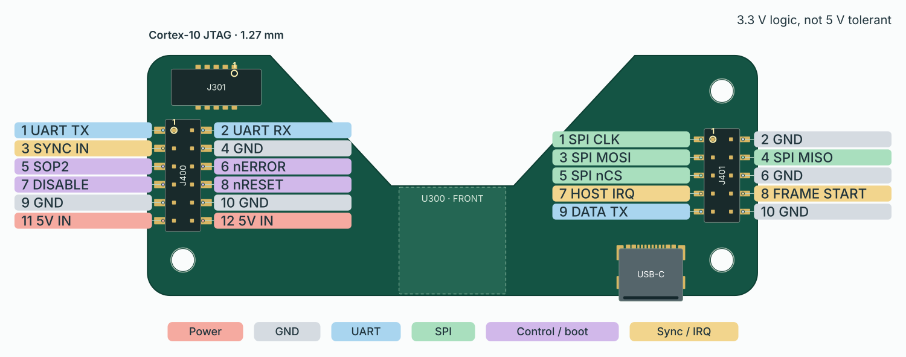
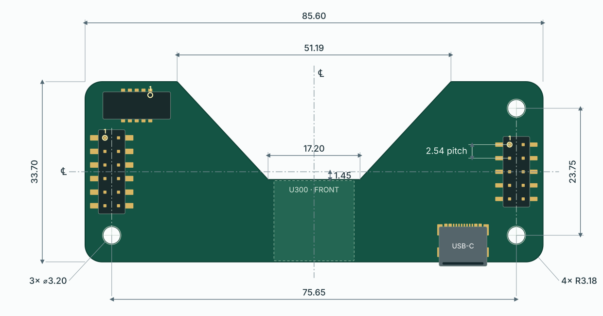

# IWR-AOP-MODULE

**Revision 1.0** · KiCad 10 · six-layer, 85.6 × 33.7 mm · in production

A self-contained 60 GHz mmWave radar module built around TI's **IWR6843AOP** (antenna-on-package). It boots its own firmware from on-board flash and connects to a PC over USB-C or a carrier through two rear sockets.

[](docs/videos/IWR-AOP-MODULE-orbit.mp4)

## Features

- **Radar.** IWR6843AOP: 60–64 GHz FMCW, 4 GHz continuous sweep, 3 transmitters and 4 receivers with antennas in the package, C674x DSP, hardware FFT/CFAR accelerator and Arm Cortex-R4F. Detection and tracking run on the radar; the host receives results.
- **Standalone boot.** 32 Mbit QSPI flash (`U301`, MX25L3233F).
- **USB-C.** One cable supplies power and two CP2105 serial ports: control/flashing and radar data. BOOT and RESET buttons select flashing mode.
- **Carrier.** 5 V input, UART and SPI, boot-mode select, reset, disable, interrupt, hardware frame-start pulse and frame-sync input.
- **Power.** USB-C or carrier 5 V feeds an ideal-diode OR and four-rail TI LP87524J-Q1 PMIC. The PMIC sequences the rails, holds the radar in reset until they are good, and asserts reset when the carrier disables them.
- **Debug.** Rear Cortex-10 JTAG header for development off a carrier (Black Magic Probe or XDS110), debug-boot solder jumper, and test pads for every rail, enable and reset. Flashing requires only USB and the BOOT/RESET buttons.
- **RF-ready layout.** The radar sits on the bottom edge with a notch above it, giving the 0.2 mm antenna edge gaps TI specifies. A GND pad sits under the die on both faces.

## Key specifications

| | |
|---|---|
| Supply | 5 V (4.5–5.5 V), ≥ 1.5 A source. Design estimate: about 1.2–1.3 A peak, 0.3–0.45 A average |
| USB | USB-C, default USB power (no PD), CP2105 dual UART |
| Carrier logic | 3.3 V, not 5 V tolerant |
| Carrier sockets | `J400` 2×6 (UART, control, 5 V in) and `J401` 2×5 (SPI, data); HCTL PM254, 2.54 mm, 8.5 mm |
| Mounting | Three M3 holes |
| Board | 85.6 × 33.7 mm, 6 layers, 1.6 mm, ENIG, filled and capped vias |
| Parts | 141 assembled on 39 BOM lines, both sides (`C605` left unfitted) |

Full modes, rails, boot, mechanics, stackup and firmware requirements: **[hardware specification](docs/STG-HW-SPEC-004_IWR-AOP-MODULE.md)**.

## Using it

Use USB-C or a carrier, never both: they share the radar's control UART.

### USB-C

Power from a USB-C port or charger offering at least 1.5 A (default USB power, no PD). USB-A-to-C cables and 500/900 mA ports can brown out during chirps. The CP2105 bridge enumerates as two COM ports:

| Channel | COM port | Radar side | Direction | Use |
|---|---|---|---|---|
| Control | *Enhanced* (ECI) | UARTA | Both | Commands, configuration, UART flashing |
| Data | *Standard* (SCI) | UARTB TX | Radar → PC | Data stream |

| Action | How |
|---|---|
| Reset | Press RESET |
| Flash | Hold RESET, hold BOOT, release RESET, release BOOT; program over the Enhanced port; press RESET to boot from flash |
| JTAG | `J301` Cortex-10 header (1.27 mm); bridge `JP300` for debug boot (spec §4.3) |

### Carrier

Power from one regulated 5 V supply (4.5–5.5 V, ≥ 1.5 A) on `J400.11/.12`, with USB unplugged. All logic is 3.3 V and not 5 V tolerant. A carrier can talk to the radar three ways:

| Channel | Radar side | Pins | Direction | Use |
|---|---|---|---|---|
| Control UART | UARTA | TX `J400.1`, RX `J400.2` | Both | Commands, configuration, UART flashing (same UART as the USB Enhanced port) |
| Data UART | UARTB TX | `J401.9` | Radar → carrier | Data stream (same as the USB Standard port) |
| SPI | SPIA, radar is peripheral | CLK `J401.1`, MOSI `J401.3`, MISO `J401.4`, CS `J401.5`; IRQ `J401.7` | Both | Protocol set by the radar firmware |

Control and timing signals:

| Signal | Pin | Direction | Function |
|---|---|---|---|
| `HOST_NRESET` | `J400.8` | Open-drain, both | Pull low to reset. High means rails good and reset released |
| `HOST_DISABLE` | `J400.7` | In, active high | High turns off every radar rail |
| `AOP_SOP2` | `J400.5` | In | Boot select: high during reset enters UART flashing |
| `AOP_NERROR_OUT` | `J400.6` | Out, open-drain | Radar error flag (optional) |
| `HOST_SYNC_IN` | `J400.3` | In | Frame trigger, 25 ns–4 µs pulse (optional) |
| `FRAME_START` | `J401.8` | Out | Frame-start pulse (optional) |

To flash from a carrier: hold `J400.5` high, pulse `J400.8` low, program over the control UART, release `J400.5` and reset again.

Carrier rules (spec §5):

- Keep every carrier output and pull-up high-impedance until `J400.8` first goes high, and while `HOST_DISABLE` is asserted.
- Reset only by pulling `J400.8` low open-drain; never drive it high.

## Pinout



Back view: `J400` is on the left and `J401` on the right.

Full pin directions and carrier rules: spec §5.

## Mechanical



Back view, mm. Everything is symmetric about the board centrelines (℄). Sockets sit on the hole columns, centred vertically. Keep carrier metal out of the antenna aperture (spec §6).

## Cost

First JLCPCB order, 5 boards (USD at €1 = $1.121, 5 October 2026):

| | 5 boards | Per board |
|---|---|---|
| PCB | $31.85 | $6.37 |
| Assembly, including parts | $341.61 | $68.32 |
| **Total** | **$373.46** | **$74.69** |

The IWR6843AOP is about $21 of each board. Per-part prices: [docs/bom-cost.csv](docs/bom-cost.csv).

## Repository layout

```
IWR-AOP-MODULE.kicad_pro / .kicad_sch / .kicad_pcb / .kicad_dru   KiCad 10 project, design rules
IWR-AOP-MODULE.kicad_sch   Power entry, LM66200 source OR, enable, integration notes
rails.kicad_sch        LP87524J-Q1 PMIC, four radar rails, reset, test pads
aop.kicad_sch          IWR6843AOP, crystal, boot flash, straps, JTAG
interfaces.kicad_sch   USB-C, CP2105 dual UART, J400 / J401 sockets, buttons
libraries/             Project symbols, footprints and STEP 3D models (IWR-AOP-MODULE.*)
                       Sockets, JTAG header, buttons and LP87524J: LCSC/EasyEDA models fitted
                       to the pads; U200: KiCad's 4x4 QFN-24 model
docs/                  Hardware specification and BOM cost
  images/              Board renders, orbit GIF, pinout.svg and dimensions.svg
  videos/              IWR-AOP-MODULE-orbit.mp4
  3d/                  Board STEP (origin: outline top-left)
tools/
  board_svg.py         Pinout and dimension SVG generation
  render/              Blender product renders and orbit video pipeline
manufacturing/         JLCPCB package builder and output (jlcpcb/)
references/            Datasheets and JLC's sample BOM format
CHANGELOG.md           Release history
LICENSE                MIT license
build/                 Generated outputs (gitignored)
```

The project is self-contained: everything outside the stock KiCad 10 libraries is in `libraries/`.

## Status

**In production.** Revision 1.0 is fully routed. ERC is clean; DRC reports 0 unconnected and 0 schematic-parity issues, plus 36 accepted findings (spec §7.3). The bring-up checklist is spec §9.

## License

MIT — see [LICENSE](LICENSE).
