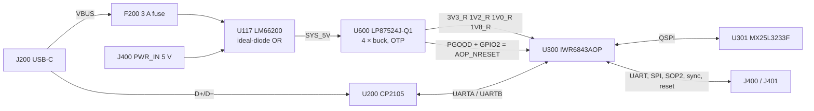
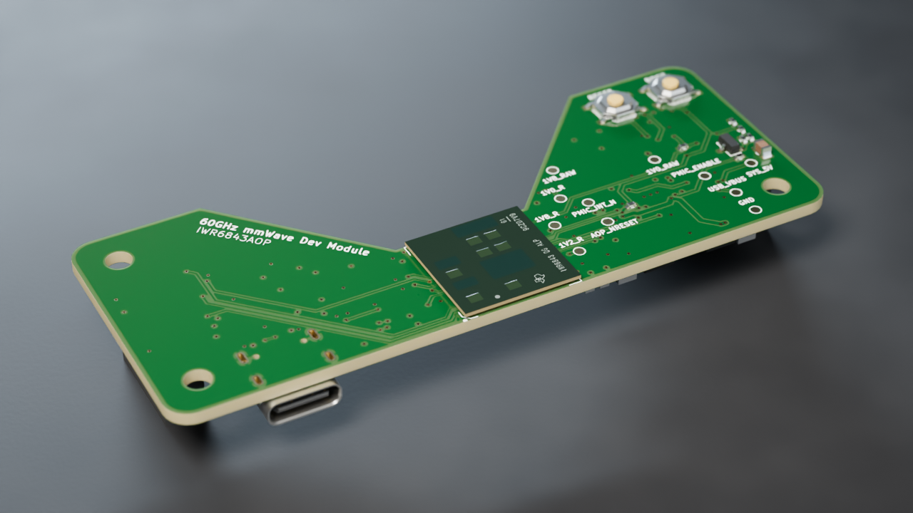
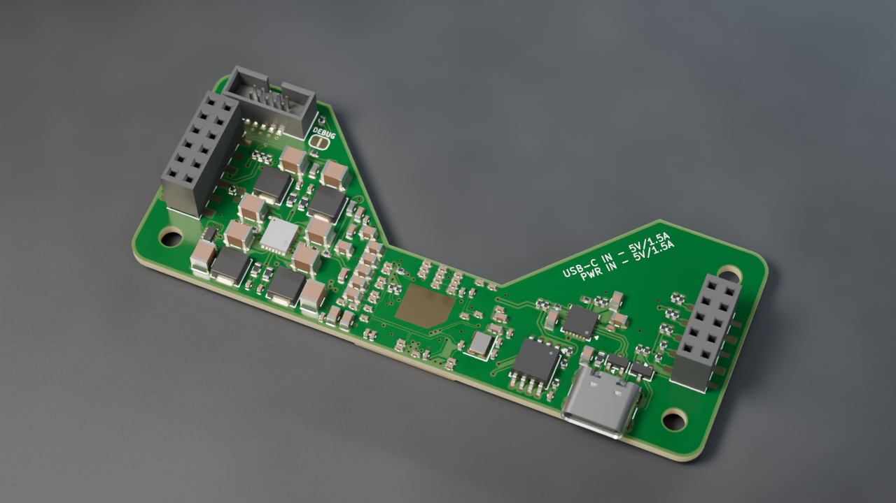

# STG-HW-SPEC-004 — IWR-AOP-MODULE design specification

**Document:** STG-HW-SPEC-004 · **Version:** 1.0 · **Date:** 5 October 2026 · **Board revision:** 1.0 (in production)

This is the design reference for the module: how it works, how to connect to it, how it's built, and what still has to be measured on the first assembled boards. The [README](../README.md) is the short overview.

All coordinates are KiCad board millimetres, viewed from the top. Parts on the bottom (`B.Cu`) are given at the position a top-view observer sees; the frame is not mirrored.

---

## 1. Architecture

| Block | Parts |
|---|---|
| Radar | `U300` IWR6843ARQGALPR (60–64 GHz, 3 TX / 4 RX antenna-on-package), `Y300` 40 MHz crystal, `U301` MX25L3233F 32 Mbit QSPI boot flash |
| Power input | `J200` USB-C (GCT USB4105-GF-A), `F200` 3 A fuse, `D201` CC ESD; `J400.11/.12` carrier 5 V; `U117` LM66200 dual ideal diode |
| Rails | `U600` LP87524J-Q1 four-phase buck PMIC (OTP-configured), `FB600`/`FB601` ferrites on the 1.0 V and 1.8 V rails, `C624`/`C625` 22 µF bulk at the radar |
| USB UART | `U200` CP2105 dual UART bridge, `D200` D+/D− ESD |
| Control | `SW400` RESET, `SW401` BOOT, `Q402` carrier disable, `R604`/`C605` reset-source option, `R417` carrier reset series resistor |
| Debug | `J301` Cortex-10 JTAG (2×5, 1.27 mm), `JP300` debug-mode solder jumper |
| Carrier | `J400` 2×6 and `J401` 2×5 HCTL PM254 2.54 mm SMD sockets on the back |
| Test | `TP602`–`TP612` 1 mm pads on the front (rails, enable, reset, interrupt, GND) |

The board carries 141 assembled parts (12 front, 129 back) on 39 BOM lines, plus one do-not-populate part (`C605`), the solder jumper `JP300`, three M3 holes, the die thermal pad `TH300` and eleven test pads.

## 2. Operating modes

The module runs in one of two modes, set by what is plugged in. Both sources pass through `U117`, so an accidental double attach cannot back-feed either supply, but the shared radar UART is not arbitrated.

| Mode | Power | UART | SPI / boot / reset / disable |
|---|---|---|---|
| **USB-only** (no carrier) | USB-C default 5 V, ≥ 1.5 A source | CP2105: ECI = radar control/flash, SCI = telemetry in | Local BOOT/RESET buttons |
| **Carrier-only** (USB unplugged) | `J400.11/.12` `PWR_IN`, regulated 5 V | Carrier on `J400.1/.2` and `J401.9` | Carrier on `J401` and `J400.3/.5–.8` |
| USB and carrier together | Not supported. Power is protected; UART RX contends (carrier wins: `R209` 100 Ω against `R208` 1 kΩ) | — | — |
| 3.3 V on `PWR_IN` | Not supported: Buck0 cannot regulate 3.3 V, so PGOOD never releases reset | — | — |

## 3. Power

### 3.1 Input

- **USB-C sink.** `R100`/`R101` 5.1 kΩ 1 % Rd on CC1/CC2: the source supplies default USB power (vSafe5V) with no PD negotiation. Use a USB-C source advertising ≥ 1.5 A. USB-A-to-C cables and 500/900 mA ports are not supported and may brown out during chirps.
- **Source OR.** `U117` LM66200: VIN1 = `USB_VBUS` (after `F200`), VIN2 = `PWR_IN`, VOUT = `SYS_5V`, ON tied low (always enabled). The higher input supplies the output; 2.5 A per channel; controlled output slew at power-up. `C100` 1 µF on `USB_VBUS`, `C140` 10 µF on `PWR_IN`.
- **Why 5 V only.** Buck0 makes 3.3 V and needs ≥ 0.5 V headroom (LP87524J-Q1 datasheet). From a 3.3 V input it falls below its PGOOD window and `AOP_NRESET` never releases.
- **Budget (design estimate, not measured).** About 1.2–1.3 A peak and 0.3–0.45 A average at 5 V, dominated by radar chirps with three transmitters. Size any 5 V supply for ≥ 1.5 A. No power is exported on any connector.

### 3.2 Rails

`U600` LP87524J-Q1 runs from `SYS_5V` (`VIN_Bx`, `VANA`, `NRST`) at 4 MHz with 0.47 µH inductors (`L600`–`L603`). Its OTP sets every output; the design makes no I²C writes (`PMIC_SCL`/`PMIC_SDA` only carry the 10 kΩ pull-ups the part requires).

| Buck | Rail | Loads | Start-up (OTP) |
|---|---|---|---|
| Buck3 | `1V8_RAW` → `FB601` → `1V8_R` | Radar analog, clock, LVDS supply | 0 ms |
| Buck2 | `1V0_RAW` → `FB600` → `1V0_R` | Radar RF and PA supply (internal LDOs bypassed) | 2 ms |
| Buck0 | `3V3_R` | Radar I/O, QSPI flash, pull-ups (≈ 70 mA max) | 5 ms |
| Buck1 | `1V2_R` | Radar digital core and SRAM | 5 ms |

Buck2 and Buck3 sense after their ferrites, at the radar load. The OTP order brings 1.8 V up before 3.3 V, as the IWR6843AOP requires (errata MSS#38A).

`C624` and `C625` (22 µF X5R 0805) sit on the back beside `C620`/`C312`, at the radar end of the 1.0 V and 1.8 V rails. They bring the total output capacitance to about 71 µF on Buck2 and 66 µF on Buck3, under the datasheet's 100 µF per single-phase output. The extra bulk reduces the dip when chirps step the 1.0 V current (up to 2 A, IWR6843AOP Table 7-3): TI's load-step figure is ±40 mV for 0.1 → 2 A in 1 µs with 44 µF, the same size as the PGOOD undervoltage threshold (§3.3).

### 3.3 Enable and reset

- **Enable.** `R133` pulls `PMIC_ENABLE` (EN1, all four bucks) up to `SYS_5V`. The carrier's `HOST_DISABLE` (`J400.7`, active high, `R414` default low) turns on `Q402`, which pulls EN1 low and removes every radar rail including `3V3_R`. `SYS_5V` stays up.
- **Reset.** `AOP_NRESET` is pulled up to `3V3_R` by `R603` 10 kΩ and has two open-drain PMIC sinks:
  - **PGOOD**, through `R604` 0 Ω (net `PMIC_PGOOD`). It watches all four bucks with a window of −29 to −53 mV and +39 to +64 mV around each DC output. It releases reset 10–13 ms after the last rail settles, about 16–19 ms after EN1 rises, and re-asserts it when an enabled rail stays outside its window for more than 4–10 µs. A buck that is disabled, in its shutdown delay or ramping down is ignored (SNVSAW2B Table 6), so PGOOD alone stays released while the rails collapse after EN1 falls.
  - **GPIO2** (pin 15). The OTP makes it an open-drain output that follows EN1: low 0 ms after EN1 falls, released 5 ms after EN1 rises (SNVU663A Table 3-9). It asserts reset as soon as `HOST_DISABLE` is applied, before the rails decay, and releases before PGOOD, so it doesn't change start-up.
  - **Fallback.** If bring-up shows radar load steps tripping PGOOD (resets during frames), remove `R604` and fit `C605` 1 µF (`C15849`). Reset then releases about 6.5 ms after `3V3_R` rises (R603 × C605 to the 1.57 V input threshold) and GPIO2 still asserts it on disable, but rail faults no longer reset the radar.
  - Other open-drain sinks on `AOP_NRESET`: `SW400`, `J301.10`, and the carrier on `J400.8` through `R417` 1 kΩ (net `HOST_NRESET`).
  - A protection shutdown (thermal, overvoltage, short circuit) holds PGOOD low while its fault flag is pending, and nothing on the board can clear it over I²C. Removing 5 V recovers; cycling `HOST_DISABLE` should too (it re-enables the bucks) but is unverified.

## 4. Radar, boot and UART

### 4.1 UART paths

| Signal | Radar ball | Connected to |
|---|---|---|
| `AOP_UART_TX` (UARTA TX) | U16 | CP2105 `RXD_ECI`, `J400.1` |
| `AOP_UART_RX` (UARTA RX) | V16, via `R314` 0 Ω | CP2105 `TXD_ECI` through `R208` 1 kΩ; carrier `J400.2` through `R209` 100 Ω; `R416` 10 kΩ pull-up to `3V3_R` |
| `AOP_DATA_TX` (UARTB TX) | E2 | CP2105 `RXD_SCI`, `J401.9` |

- `R208` limits current from the CP2105 (powered from USB at 3.45 V) into the radar while the PMIC is still starting, and lets a carrier override it.
- In carrier-only mode the CP2105 is unpowered. Its UART pins tolerate VIO + 3.6 V unpowered (CP2105 datasheet, Table 1), so radar traffic does not back-power it.
- Removing `R314` isolates the radar RX ball (V16) from the CP2105 and the carrier, for rework or an external UART.

### 4.2 Boot

| Mode | SOP2/SOP1/SOP0 | How |
|---|---|---|
| Normal (QSPI flash) | 0/0/1 | BOOT released, then reset |
| UART flashing (SOP5) | 1/0/1 | USB-only: hold RESET, hold BOOT, release RESET, release BOOT; flash over the CP2105 ECI port. Carrier-only: the carrier drives `J400.5` `AOP_SOP2` |
| JTAG debug | 0/1/1 | BOOT released; bridge `JP300` (SOP1 high), then reset. Clear `JP300` to return to normal boot |

`SW401` drives `AOP_SOP2` through `R410` 1 kΩ. Don't press BOOT while a carrier is driving `SOP2`. Change straps only while reset is held.

The MX25L3233F ships with its QE bit cleared. Flashing must set the non-volatile QE bit (status register bit 6) before the radar can boot in quad mode; wait for WIP = 0 before any reset (errata MSS#45). The part is on TI's list of compatible flash (SPRACH9G).

### 4.3 Debug header and jumper (back)

`J301` is a standard ARM Cortex 10-pin (1.27 mm, 2×5, shrouded) JTAG header on the back, wired for the Black Magic Probe or TI XDS110. It shares the back with the carrier sockets, so it is for development off a carrier (USB power + JTAG); an integrated module on a carrier doesn't use it. The 5.6 mm header body sits under the 8.5 mm socket mating height, so the carrier needs a clear area beneath it.

| Pin | `J301` | Pin | `J301` |
|---|---|---|---|
| 1 | VTref (`3V3_R`) | 2 | TMS (U8) |
| 3 | GND | 4 | TCK (T3) |
| 5 | GND | 6 | TDO (U10, shared with SOP0) |
| 7 | key, no connection | 8 | TDI (U9) |
| 9 | GND | 10 | `AOP_NRESET` |

- The header supplies no power. Keep the probe's target power off (Black Magic Probe: `monitor tpwr disable`, the default); pin 1 is the radar's 3.3 V rail. Never drive a pin while `3V3_R` is off. Start JTAG at 1 MHz.
- The radar's R4F sits behind TI's ICEPick JTAG router. Black Magic Debug v2.1.0 supports ICEPick on AM335x and TMS570; this part is not on its list, so confirm the attach on the first board (TI XDS110 is the known-good fallback). JTAG does not program the QSPI flash; flash over UART (§4.2).
- JTAG attaches in normal boot (0/0/1) with the application running. For debug mode (0/1/1: bootloader bypassed, R4F halted) bridge `JP300`, a two-pad solder jumper (`SolderJumper-2_P1.3mm_Open`) from SOP1 to `3V3_R`. Change it unpowered or with reset held, and clear it for normal boot.

## 5. Carrier interface

Two HCTL PM254 SMD sockets on the back, 2.54 mm pitch, 8.5 mm nominal height, both rotated 180° with pin 1 toward the top edge and odd/even numbering across the rows. `J400` sits on the right edge (next to the PMIC), `J401` on the left; the split follows the radar's ball groups so no signal crosses the antenna gap.

| Pin | `J400` PM254-2-06-S-8.5 (C3975151): UART / control / power | `J401` PM254-2-05-S-8.5 (C3975150): SPI / data |
|---|---|---|
| 1 | `AOP_UART_TX` (out) | `HOST_SPI_CLK` (in) |
| 2 | `HOST_UART_TX` (in) | GND |
| 3 | `HOST_SYNC_IN` (in) | `HOST_SPI_MOSI` (in) |
| 4 | GND | `AOP_SPI_MISO` (out) |
| 5 | `AOP_SOP2` (in, boot select) | `HOST_SPI_CS_N` (in) |
| 6 | `AOP_NERROR_OUT` (out, open-drain) | GND |
| 7 | `HOST_DISABLE` (in, active high) | `AOP_HOST_INTR` (out) |
| 8 | `HOST_NRESET` (open-drain, bidirectional; `AOP_NRESET` through `R417` 1 kΩ) | `FRAME_START` (out) |
| 9 | GND | `AOP_DATA_TX` (out) |
| 10 | GND | GND |
| 11 | `PWR_IN` 5 V | — |
| 12 | `PWR_IN` 5 V | — |

All logic is 3.3 V (`3V3_R`); none of it is 5 V tolerant. Carrier rules:

1. `PWR_IN`: one regulated 5 V supply, 4.5–5.5 V at the pins, on both contacts. Unplug USB.
2. Keep every carrier output and pull-up on a radar signal high-impedance while `3V3_R` is off: until `J400.8` first goes high, and whenever `HOST_DISABLE` is asserted. Release them before asserting `HOST_DISABLE`. `J400.8` goes low as soon as `HOST_DISABLE` is applied (§3.3).
3. Reset the radar by pulling `J400.8` low with an open-drain output. Never drive it high. High means all rails are good and reset is released. Through `R417` a carrier low reaches the radar as about 0.3 V (input low threshold 0.65 V).
4. Never drive `J400.2` while USB is attached.
5. `HOST_SYNC_IN` (frame trigger in), `FRAME_START` (hardware frame-start pulse out) and `AOP_NERROR_OUT` are optional; leave them open if the carrier firmware doesn't use them. A `SYNC_IN` pulse must be > 25 ns and < 4 µs (errata MSS#44A).
6. SPI is the radar's SPIA in peripheral mode (pinmux 1); the protocol is defined by the radar firmware.

**Keying.** A centred 2×5 header can seat on the middle of the 2×6 socket, so the different lengths don't stop a 180° reversal. Offset the headers on the carrier or block a hole.

## 6. Mechanical

| Item | Value |
|---|---|
| Outline | 85.6 × 33.7 mm, 3.18 mm corner radii, x 106.279–191.879, y 94.546–128.246 |
| Top-edge notch | Open trapezoid (123.484, 94.546) → (140.479, 112.846) → (157.679, 112.846) → (174.674, 94.546): 17.2 mm wide at the bottom, 51.19 mm at the edge, 18.3 mm deep |
| Radar `U300` | (149.079, 120.546), 90°, front. 15 × 15 mm package |
| Antenna (E-plane) gaps | The bottom board edge and the bottom of the notch are each 0.20 mm from the package, inside TI's < 0.3 mm requirement (SWRZ092B PACKAGE#02) |
| Mounting holes | Three 3.2 mm NPTH for M3: `H1` (111.254, 99.521), `H4` (111.254, 123.271), `H3` (186.904, 123.271); ≈ 5 mm from the adjacent edges. No hole at the top right |
| Carrier sockets | `J401` (111.254, 111.396), `J400` (186.904, 111.396): back, 180°, on the hole columns, centred vertically; 75.65 mm apart |
| Debug header and jumper | `J301` (182.235, 99.000), back; `JP300` (173.625, 101.050), back |
| USB-C | `J200` (121.230, 125.359), back, opening at the bottom edge |
| Mating height | Socket designation and model say 8.5 mm. Not measured: confirm with purchased sockets and headers before fixing carrier standoffs |

**Keep-outs.** `U300` carries two named all-copper keep-outs (`IWR6843AOP_EPlane_Column1`, `IWR6843AOP_EPlane_Column18`) on all six layers. Keep carrier metal, cables and enclosure walls out of the antenna aperture; the antenna faces broadside from the front.

**Die thermal pad.** The radar die sits in the ball-free centre of the package (SWRS237C p.84). Board-only `TH300` places a GND pad under it on both faces: same outline, mask open, no paste. The `AOP_backside_thermal_reserve` rule area keeps components off that outline on the back; copper and vias are allowed.

## 7. PCB and fabrication

### 7.1 Stack

| Layer | KiCad | Role |
|---|---|---|
| L1 | `F.Cu` | Signals, local power, GND pour |
| L2 | `In1.Cu` | GND plane |
| L3 | `In2.Cu` | Signals (referenced to L2) |
| L4 | `In3.Cu` | Power partitions |
| L5 | `In4.Cu` | GND plane |
| L6 | `B.Cu` | Signals, local power, GND pour |

1.6 mm FR-4, ENIG. The board file carries a nominal stack (dielectrics 0.10 / 0.10 / 1.04 / 0.10 / 0.10 mm) that keeps L3 next to GND and away from the split L4. No trace is impedance-controlled (USB is full speed through the CP2105), so any JLC 6-layer 1.6 mm stack is usable. Prefer one where L3 is closer to L2 than to L4; JLC06161H-3313 is the opposite (L3 0.109 mm from L4, 0.55 mm from L2).

### 7.2 Vias and rules

- **Every via is epoxy filled and copper capped** (IPC-4761 Type VII; JLC's free POFV on 6–20 layers). This is what allows via-in-pad at `U300`, `U600` and the radar passives. The board's via flags say the same (filling yes, capping yes). Don't accept ink plugging.
- Vias: 195 × 0.45/0.30 mm, 6 × 0.60/0.30 mm, 2 × 0.40/0.25 mm (`U300` GND balls A2/F3). Minimum track 0.15 mm.
- Custom rules (`IWR-AOP-MODULE.kicad_dru`): 0.09 mm trace/space and 0.15 mm hole clearance inside the `U300` escape; 0.10 mm to `U300` pads; via 0.35 mm minimum, drilled hole 0.20–0.50 mm (the fill process window); same-net via-in-pad allowed; 0.2 mm edge clearance only inside the E-plane keep-outs; the USB-C receptacle's own shell-post geometry.

### 7.3 Accepted check results

ERC: 0 violations. DRC with schematic parity: 0 unconnected, 0 parity, and these accepted findings:

| Finding | Count | Why accepted |
|---|---|---|
| `hole_clearance` error at `U600` | 7 | Filled, capped vias in the PMIC's pads under no-net back-paste apertures; covered by the via process |
| `silk_over_copper` warning | 17 | Silkscreen clipped by mask openings and vias (outlines of `J301`, `J400`, `U301`, `SW401` over vias); JLC clips silk on exposed copper |
| `text_height` warning | 12 | Test-pad net labels and the `JP300` "DEBUG" label at 0.7 mm |

### 7.4 Ordering

The JLCPCB package and its build script are in [`manufacturing/`](../manufacturing/README.md).

## 8. Firmware requirements

1. Before `MMWave_open()`, configure the external 1.0 V supply: `rlRfSetLdoBypassConfig()` with `ldoBypassEnable = 3` (RF LDO bypass and PA LDO disabled), `ioSupplyIndicator = 0` (3.3 V I/O), and set `supplyMonIrDrop` for this board. Three-transmitter operation needs this mode (SWRS237C). The internal RF/PA LDOs must never drive the external 1 V rail.
2. Set the flash's non-volatile QE bit when programming; wait for WIP = 0 before reset (§4.2).
3. Pinmux: UARTA RX V16 mode 2, TX U16 mode 5; UARTB TX E2 mode 6; SPIA D2/C2/F2/D1 mode 1; `FRAME_START` K3 mode 13; `SYNC_IN` U12 mode 1. Keep LVDS disabled.
4. `VBGAP` (A16) has 47 nF; the reference outputs on A9/A10 are decoupled only.
5. Carrier firmware: follow the rules in §5 (Hi-Z while `3V3_R` is off, open-drain reset only).

## 9. Bring-up checks

Revision 1.0 is in production. Measure on the first assembled boards:

1. **Assembly.** Check every part in JLC's placement preview, especially `U300` (BGA), `U600`, `U117`, `U200`, `U301`, `D200`/`D201` and the sockets.
2. **Rails.** At the test pads, check `SYS_5V`, `1V8_R`, `1V0_R`, `3V3_R` and `1V2_R` and the start-up order. `TP608`/`TP609` give the pre-ferrite `1V0_RAW`/`1V8_RAW`.
3. **USB-C start-up** on 1.5 A and 3 A sources: inrush into the `SYS_5V` capacitance, droop at chirp peaks, cable drop.
4. **Reset.**
   - `AOP_NRESET` (`TP603`) releases 10–13 ms after the last rail settles (about 16–19 ms after EN1 rises) and re-asserts on an induced rail fault.
   - With `HOST_DISABLE` applied, `TP603` falls before `1V2_R` and `1V0_R` leave their windows (GPIO2).
   - Run three transmitters at the maximum-duty chirp profile, hot and cold, with the scope triggered on `TP603` falling and `1V0_R` AC-coupled: no resets during frames. If PGOOD trips, apply the §3.3 fallback (`R604` out, `C605` in).
   - Boot from flash and in UART flashing mode.
5. **Back-power.** No `3V3_R` lift or latch-up from the CP2105 driving through `R208` while the PMIC starts.
6. **Rail quality.** `1V0_R`/`1V8_R` ripple during chirps with three transmitters.
7. **Current.** Input current per mode, peak and inrush. Don't publish a rating from datasheet values alone.
8. **Carrier fit.** Socket height, header fit, standoffs and keying with purchased parts.

## 10. Limits

- No USB PD; default USB power only.
- No independent supervisor: reset release relies on the PMIC's PGOOD window, or on the `R603`/`C605` RC if the §3.3 fallback is fitted.
- No RF, thermal or current qualification yet. The 0.2 mm antenna gaps are geometry, not measured RF performance.
- USB and carrier together, 3.3 V on `PWR_IN`, or driving `J400.8` high are outside the design.
- Supply limit: `U301` MX25L3233F (C190802) is an extended part with thin JLC stock (38 on 2 October 2026, 3 on 5 October 2026). Check stock before each assembly order.

## 11. Sources

Datasheets used by this design are in [`references/datasheets/`](../references/datasheets/).

| Topic | Source |
|---|---|
| Radar pinout, supplies, rail currents, reset timing, die location, 3-TX LDO bypass | TI IWR6843AOP datasheet SWRS237C |
| E-plane gap (PACKAGE#02), errata MSS#38A/#41/#44A/#45, ANA#16/#18B/#19 | [TI SWRZ092B](https://www.ti.com/lit/er/swrz092b/swrz092b.pdf) |
| Thermal pad practice under the die | [TI SWRA672](https://www.ti.com/lit/an/swra672/swra672.pdf) |
| PMIC headroom, PGOOD window, delay and masking (Table 6), load step, output-capacitance limit, EN rating | TI LP87524J-Q1 datasheet SNVSAW2B |
| PMIC OTP start-up order, GPIO2 and PGOOD configuration | TI SNVU663A, Tables 3-8, 3-9 and 3-10 |
| Source OR behaviour | TI LM66200 datasheet |
| CP2105 unpowered pin rating | [Silicon Labs CP2105 datasheet](https://www.silabs.com/documents/public/data-sheets/CP2105.pdf), Table 1 |
| Flash compatibility | TI SPRACH9G; Macronix MX25L3233F datasheet |
| Carrier sockets | [HCTL PM254-2-06-S-8.5](https://wmsc.lcsc.com/wmsc/upload/file/pdf/v2/lcsc/2306091018_HCTL-PM254-2-06-S-8-5_C3975151.pdf) · [PM254-2-05-S-8.5](https://wmsc.lcsc.com/wmsc/upload/file/pdf/v2/lcsc/2306091018_HCTL-PM254-2-05-S-8-5_C3975150.pdf) |
| Via-in-pad process | [JLCPCB free POFV on 6–20 layers](https://jlcpcb.com/news/free-via-in-pad-6-20-layer-pcbs-pofv) · [JLCPCB BGA guidelines](https://jlcpcb.com/help/article/bga-design-guidelines---pcb-layout-recommendations-for-bga-packages) · IPC-4761 |
| JLC 6-layer stacks | <https://jlcpcb.com/impedance> |
